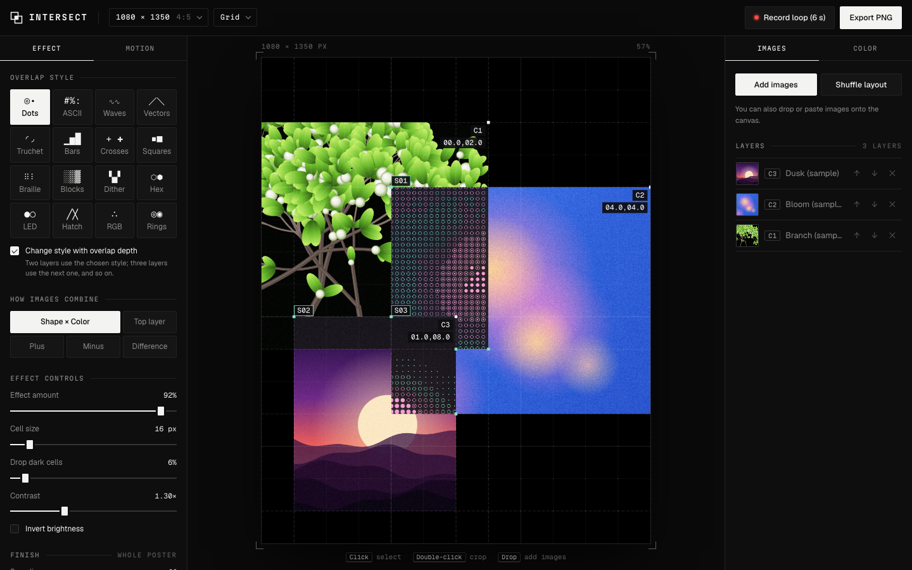

# Intersect

**The overlap is the art.**



Most image effects change the whole picture. Intersect only touches the places where your images overlap. Pick a canvas size, add your images and move them around the grid. Every intersection turns into its own piece of art (dot matrix, ASCII, braille, dithering, hatching and more), while the rest of each image stays exactly as it was. Inside the overlap, the shape can come from one image and the color from the other.

Everything runs in your browser. Images never leave your device, and there's nothing to sign up for.

## What it does

- **Overlaps follow the real pixels:** transparent PNGs, rotated layers, shaped frames and letterforms all shape where the effect appears.
- **Text layers:** five typefaces with weight, italic, size, letter spacing, line height, alignment and color. Text cuts through images by default (where letters cross an image they become the effect), or sits on top as normal type.
- **Cutouts:** transparent PNGs are trimmed to their subject automatically. **Remove background** runs on your device: Person (7 MB) or Any subject (115 MB, needs WebGPU). The model downloads once.
- **Frame shapes:** rectangle, rounded, circle, pill, arch, diamond and star.
- **Rotation:** drag the round handle (Shift snaps to 15°) or use the slider.
- **Layer motion:** Slide, Pass, Orbit, Bounce, Sway, Spin and Pulse, each with amount, direction, start offset and speed. Everything loops seamlessly.
- **Per-overlap control:** click an S label (or pick it from the Overlaps list) to give one overlap its own style, cell size or colors, or switch its effect off.
- **Looks:** seven built-in looks (Signal, Image colors, Terminal, Riso, Blueprint, Newsprint, Gold braille), plus your own saved looks.
- **Projects:** save the whole poster, images included, as a `.intersect` file and open it later.
- **16 overlap styles:** Dots, ASCII, Waves, Vectors, Truchet, Bars, Crosses, Squares, Braille, Blocks, Dither, Hex, LED, Hatch, RGB drops and Rings. Areas where three images overlap can switch to the next style automatically.
- **5 ways to combine images:** Shape × Color, Top layer, Plus, Minus and Difference.
- **Color:**
  - Two-tone presets
  - Gradient maps with up to six stops
  - Colors taken from the images
  - A single custom color
- **Motion:** Breathe, Wave, Scan, Drift and Glitch, plus images that hop across the grid.
- **Finish:** scan lines, RGB split, film grain and vignette.
- **Any canvas size:** Instagram post, story, square, landscape, A4/A3 poster, X header or custom.
- **Grid menu in the top bar:**
  - Adjustable grid size with snapping
  - Figma-style grid lines (never exported)
  - Background dots
- **Cropping:** double-click an image to crop it on the canvas. Drag to reposition and scroll to zoom.
- **Export:** PNG at full resolution, or an MP4 rendered frame by frame (30 or 60 fps) that loops seamlessly. You can download, copy, or share to WhatsApp and Instagram.

## Layout

- **Left panel:** Effect and Motion (styles, blend modes, effect controls, finish, animation and recording).
- **Center:** the poster.
- **Left panel:** looks live at the top of the Effect tab.
- **Right panel:** Layers and Color (layers, text, cropping, shapes, background removal, layer motion, overlaps, mark colors, surfaces).
- **Top bar:** canvas size, grid settings, Open and Save, Export MP4 and Export PNG.

## Keyboard

| Key | Action |
| --- | --- |
| Arrow keys | Nudge the selected layer by one grid cell |
| Enter | Crop an image, or edit a text layer |
| Shift while rotating | Snap to 15° |
| Shift while resizing | Keep proportions |
| Esc | Finish cropping, deselect, close dialogs |
| Delete / Backspace | Remove the selected image |

## Run it locally

It's a single HTML file with no build step. Open `index.html` in a browser, or serve the folder:

```bash
npx serve .
```

## Deploy

The site is static, so any static host works. On Vercel:

1. Import this repository at [vercel.com/new](https://vercel.com/new).
2. Leave **Framework Preset** on **Other**. There's no build command and no output directory to set.
3. Deploy. Every push to `main` redeploys automatically.

## Project structure

```
index.html          the whole app: markup, styles and script
favicon.svg         browser tab icon (plus favicon-32.png and apple-touch-icon.png)
docs/screenshot.png README screenshot
```
